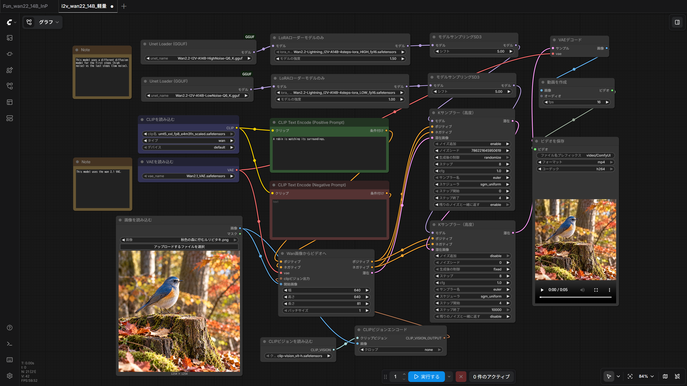

# Hi there, I'm a Local AI Creator / Architect 👋

I focus on creating 5-second silent cinematic videos using local AI, emphasizing the beauty of subtraction and subtle atmosphere ("ma").
This profile serves as a technical portfolio for running heavy AI video models efficiently on mid-range hardware.

https://github.com/user-attachments/assets/20111eb2-aa5a-4886-83c6-aa9378e0e757

---

## 🛠️ Machine Specifications & Environment
* **OS:** Windows 11
* **CPU:** Intel Core i5-12400F
* **GPU:** NVIDIA GeForce RTX 3060 Ti (VRAM 8GB)
* **RAM:** 64GB
* **Display:** Dual monitor setup (including EIZO ColorEdge CG248-4K for professional color management)

## 🚀 Local AI Workflow
### 🎥 Wan2.2 Image-to-Video / ComfyUI

The main production workflow runs **Wan2.2 I2V A14B GGUF on an RTX 3060 Ti with only 8GB of VRAM**.

> **Important:** This workflow does **not** use `ComfyUI-WanVideoWrapper`.
>
> It is built around standard ComfyUI nodes, with `ComfyUI-GGUF` used only for loading the quantized Wan2.2 diffusion models. The intention is to keep ComfyUI focused on generation rather than turning it into an all-in-one post-production pipeline.

### Design Philosophy

The workflow follows a simple division of labor:

1. **ComfyUI / Wan2.2** — Generate the raw video.
2. **Topaz Video AI** — Upscale and enhance the generated video.
3. **Adobe Premiere Pro** — Final color adjustment, framing, and export.

Upscaling, frame interpolation, and final finishing are intentionally kept outside ComfyUI. Each application performs the task it is best suited for.

---

## 🚀 Optimized Workflow

The production workflow is available in the `workflows/` directory.

The published workflow JSON uses the following generation and video output settings:

* **Generation resolution:** 640 × 640
* **Number of frames:** 81
* **Video frame rate:** 16 fps

These values describe the settings saved in the published workflow JSON.

### Wan2.2 Image-to-Video — 14B GGUF Split Sampling

The workflow uses Wan2.2's separate **HighNoise** and **LowNoise** diffusion models with two sequential `KSamplerAdvanced` nodes.

* **HighNoise model:** early denoising stage
* **LowNoise model:** late denoising stage
* **Steps:** 8 total
* **CFG:** 1.0
* **Sampler:** Euler
* **Scheduler:** SGM Uniform
* **Negative prompt:** normally left empty

The source image is not merely a visual reference. `CLIP Vision` encodes the input image and provides image conditioning to the Wan I2V pipeline. For this reason, the quality and composition of the source image are a major part of the workflow.

### Native ComfyUI Structure

The workflow deliberately stays close to ComfyUI's normal node structure:

`Load Image → CLIP Vision → Wan I2V conditioning → KSampler (HighNoise) → KSampler (LowNoise) → VAE Decode → Save Video`

The final decode uses the normal `VAEDecode` node rather than a tiled VAE decode.

---

### 📊 Memory Profile

This workflow has been tested on:

* **GPU:** RTX 3060 Ti 8GB
* **RAM:** 64GB
* **Model:** Wan2.2 I2V A14B Q6_K GGUF

The objective is not to force every operation into VRAM. Instead, the workflow keeps the generation graph simple enough for ComfyUI's memory management to run the 14B model reliably on an 8GB card.

---

### 📁 Files

* **Workflow JSON:** `workflows/i2v_wan2.2_14b_lightweight.json`
* **Input source image:** `workflows/Sample.png`
* **Sample video:** `workflows/Sample.mp4`
* **Workflow preview:**

After loading the JSON workflow, load `Sample.png` into the `Load Image` node to reproduce the sample setup.

### 🧩 Required Custom Nodes

* `ComfyUI-GGUF`

`ComfyUI-WanVideoWrapper` is **not required** by this workflow.

### 💾 Required Models & Paths

#### Diffusion Models (GGUF)
`ComfyUI/models/unet/`

* `Wan2.2-I2V-A14B-HighNoise-Q6_K.gguf`
* `Wan2.2-I2V-A14B-LowNoise-Q6_K.gguf`

#### Text Encoder
`ComfyUI/models/text_encoders/`

* `umt5_xxl_fp8_e4m3fn_scaled.safetensors` — type: `wan`

#### VAE
`ComfyUI/models/vae/`

* `Wan2.1_VAE.safetensors`

#### CLIP Vision
`ComfyUI/models/clip_vision/`

* `clip-vision_vit-h.safetensors`

#### LoRA
`ComfyUI/models/loras/`

* `Wan2.2-Lightning_I2V-A14B-4steps-lora_HIGH_fp16.safetensors`
* `Wan2.2-Lightning_I2V-A14B-4steps-lora_LOW_fp16.safetensors`

---

## 🛠️ External Tools & Post-Production

### 1. ComfyUI / Wan2.2 — Generation

ComfyUI is used only for the core I2V generation and video output. The workflow intentionally avoids unnecessary post-processing nodes.

### 2. Topaz Video AI — Enhancement & Upscaling

The generated source is passed to Topaz Video AI for high-quality upscaling. This keeps the expensive generative stage at a practical resolution while allowing the final output resolution to be handled by a dedicated enhancement tool.

In the current post-production workflow, Topaz Video AI uses the Rhea model at 4× upscaling.

### 3. Adobe Premiere Pro — Final Editing

Final framing, color adjustment, sharpening, and export are handled in Premiere Pro.

Typical Lumetri values:

* Exposure: +0.2
* Contrast: +5
* Vibrance: +10
* Saturation: 105
* Sharpening: +7

Final square output: **1920 × 1920**.

---

## 🔗 Links

* **5-second video:** https://5s-video.com
* **Instagram:** http://www.instagram.com/mii_jukuchou/

---

# 🇯🇵 日本語

ローカルAIを活用し、5秒のサイレント映像を制作しています。
このリポジトリでは、**RTX 3060 Ti / VRAM 8GBという環境でWan2.2 I2V A14Bを実運用するためのComfyUIワークフロー**を公開しています。

## 🎥 重要：WanVideoWrapperは使用していません

このワークフローでは **`ComfyUI-WanVideoWrapper` を使用していません。**

Wan専用Wrapperに処理をまとめる方式ではなく、ComfyUIの通常ノードを中心に構成し、GGUFモデルの読み込みに `ComfyUI-GGUF` を使用しています。

つまり、WanVideoWrapper独自のワークフローではなく、できるだけ**ComfyUI本来のノード構成をそのまま使ったWan2.2 I2Vワークフロー**です。

## 設計思想 — 分業制

ComfyUIですべてを完結させることを目的にしていません。

1. **ComfyUI / Wan2.2** — 動画生成
2. **Topaz Video AI** — 高画質化・アップスケール
3. **Adobe Premiere Pro** — 最終調整・書き出し

アップスケールや補間などを生成ワークフローへ追加せず、ComfyUIには動画生成そのものに集中させています。

---

公開ワークフローJSONには、以下の生成・動画出力設定が保存されています。

* **生成解像度:** 640 × 640
* **フレーム数:** 81
* **動画フレームレート:** 16 fps

これらは公開ワークフローJSONに保存されている設定です。

## 🚀 Wan2.2 I2V A14B GGUF 前後段切り替え

Wan2.2のHighNoiseモデルとLowNoiseモデルを、それぞれ2つの `KSamplerAdvanced` で前半・後半に分けて処理します。

* **HighNoise:** 前半
* **LowNoise:** 後半
* **Steps:** 8
* **CFG:** 1.0
* **Sampler:** Euler
* **Scheduler:** SGM Uniform
* **Negative Prompt:** 通常は空欄

### 元画像とCLIP Vision

このワークフローでは元画像を非常に重要視しています。

`CLIP Vision` で元画像をエンコードし、その情報をWan I2Vのコンディショニングへ渡します。そのため、長いプロンプトで映像を作り込むより、**元画像の構図と情報を活かし、プロンプトは動作を簡潔に指示する**ことを基本としています。

### ワークフロー構成

`Load Image → CLIP Vision → Wan I2V conditioning → KSampler (HighNoise) → KSampler (LowNoise) → VAE Decode → Save Video`

最終デコードにはタイルVAEではなく、通常の `VAEDecode` を使用しています。

---

## 📁 公開ファイル

* **JSON:** `workflows/i2v_wan2.2_14b_lightweight.json`
* **元画像:** `workflows/Sample.png`
* **生成サンプル:** `workflows/Sample.mp4`
* **ワークフロー画像:** `workflows/i2v_wan2.2_14b_lightweight.png`

JSONを読み込んだ後、`Load Image` ノードへ `Sample.png` を読み込めばサンプルと同じ構成になります。

### 🧩 必要なカスタムノード

* `ComfyUI-GGUF`

**`ComfyUI-WanVideoWrapper` は不要です。**

### 💾 必要モデル

#### GGUF
`ComfyUI/models/unet/`

* `Wan2.2-I2V-A14B-HighNoise-Q6_K.gguf`
* `Wan2.2-I2V-A14B-LowNoise-Q6_K.gguf`

#### Text Encoder
`ComfyUI/models/text_encoders/`

* `umt5_xxl_fp8_e4m3fn_scaled.safetensors`

#### VAE
`ComfyUI/models/vae/`

* `Wan2.1_VAE.safetensors`

#### CLIP Vision
`ComfyUI/models/clip_vision/`

* `clip-vision_vit-h.safetensors`

#### LoRA
`ComfyUI/models/loras/`

* `Wan2.2-Lightning_I2V-A14B-4steps-lora_HIGH_fp16.safetensors`
* `Wan2.2-Lightning_I2V-A14B-4steps-lora_LOW_fp16.safetensors`

---

## 🛠️ 後工程

### ComfyUI
動画生成と保存まで。

### Topaz Video AI
生成した動画のアップスケール・高画質化を担当。

現在の後工程では、Topaz Video AIのRheaモデルを使用し、4倍にアップスケールしています。

### Premiere Pro
最終的なフレーミング、カラー調整、シャープネス、書き出しを担当。

基本Lumetri設定：

* 露出量: +0.2
* コントラスト: +5
* 自然な彩度: +10
* 彩度: 105
* シャープネス: +7

最終的な正方形動画は **1920 × 1920** で出力します。

---

## 🔗 リンク

* **5秒動画:** https://5s-video.com
* **Instagram:** http://www.instagram.com/mii_jukuchou/
